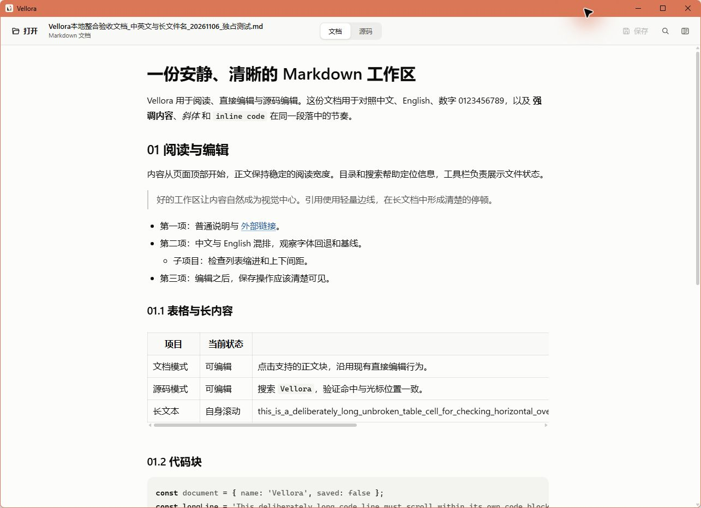

<p align="center">
  
</p>

<h1 align="center">Vellora</h1>

<p align="center">
  A local-first Markdown reader and source editor. Windows is the currently verified platform.
</p>

<p align="center">
  <a href="https://github.com/mirad-tech/vellora/actions/workflows/ci.yml"></a>
  <a href="https://github.com/mirad-tech/vellora/releases/latest"></a>
  <a href="LICENSE"></a>
</p>

<p align="center">
  <a href="README.md">中文</a> ·
  <a href="README.ja.md">日本語</a> ·
  <a href="README.ru.md">Русский</a>
</p>

<p align="center">
  
</p>

Documents are processed locally and are not uploaded to a server. Vellora is built with **Tauri 2 + React + TypeScript + Vite** and stays focused on opening, reading, quickly editing, and saving one Markdown document.

## Download

| Platform | Support status | How to get it |
|---|---|---|
| Windows 10/11 x64 | Current version: 2.4.3 | Download the NSIS installer |
| macOS | The Windows source and locally verified version is **2.4.3**. The `mac/` build scripts have been removed; remaining macOS npm/CI entries are not currently usable. | — |

### Windows 10/11 x64

[**Download Vellora 2.4.3 (NSIS)**](https://github.com/mirad-tech/vellora/releases/download/v2.4.3/Vellora_2.4.3_x64-setup.exe)

- All versions: [GitHub Releases](https://github.com/mirad-tech/vellora/releases)
- Requires Microsoft WebView2, normally included with Windows 10/11; the installer can bootstrap it if missing
- When upgrading from Electron 1.x, uninstall 1.x first; uninstalling does not remove Markdown documents

### macOS

The Windows source and locally verified version is **2.4.3**. The `mac/` build scripts have been removed; remaining macOS npm/CI entries are not currently usable.

## Features

- Open `.md` / `.markdown` through the picker, drag-and-drop, or file association
- Render headings, lists, quotes, tables, fenced code, links, and relative images
- Switch between reading and lightweight source editing
- Edit document text, code, nested lists and tables continuously, with undo and source-mode switching
- Compact in-document search in read and source modes, with result counts and previous/next navigation
- Collapsible outline that follows the current reading position
- Unsaved-change confirmation before close or document switches
- Directory-bounded local Markdown links and confirmed HTTP(S) external links
- Single-instance file forwarding

The interface uses a low-emphasis warm-paper palette. Read and source modes share the window-edge scrollbar, and syntax highlighting stays intentionally restrained.

## Keyboard shortcuts

| Shortcut | Action |
|---|---|
| `Ctrl+S` / `⌘S` | Save |
| `Ctrl+F` / `⌘F` | Find in document |
| `Enter` / `Shift+Enter` | Next / previous match |
| `Escape` | Close the active search or confirmation overlay |
| `Ctrl+Enter` / `⌘Enter` | Leave a code block or raw source fragment |

Save and Find are available in the toolbar and through Ctrl+S / Ctrl+F. Reopening Find preserves the query and restores focus.

## Build from source

Requirements: Windows 10/11; Node.js 22.22.2+ on the 22.x line, 24.15+ on the 24.x line, or 26+; [Rust MSVC](https://rustup.rs/); Visual Studio C++ Build Tools; and WebView2.

```powershell
npm ci
npm run dev
npm run typecheck
npm test
npm run test:rust
npm run build:web
npm run dist
```

Installer output:

`src-tauri/target/release/bundle/nsis/Vellora_2.4.3_x64-setup.exe`

The Windows source and locally verified version is **2.4.3**. The `mac/` build scripts have been removed; remaining macOS npm/CI entries are not currently usable.

## Security

- Opens and saves `.md` / `.markdown` only
- Images and local Markdown links stay within the current document directory; images are limited to 10 MiB
- External URLs are HTTP(S) only and require confirmation
- Tauri capabilities expose only the required custom commands
- Documents are not uploaded; uninstall does not delete user files

## Repository and releases

The Windows source and locally verified version is **2.4.3**. The `mac/` build scripts have been removed; remaining macOS npm/CI entries are not currently usable. Windows checks cover version consistency, types, unit tests, builds, browser and native UI regression. A matching version tag triggers the Windows installer release workflow.

- [Changelog](CHANGELOG.md)
- [Issues](https://github.com/mirad-tech/vellora/issues)
- [MIT License](LICENSE)

App id: `app.markdown-viewer.desktop`.

## UI regression

```powershell
npm run version:check
npm run test:e2e:prepare
npm run test:e2e
npm run tools:msedgedriver
npm run test:e2e:desktop
```

[Chrome and tauri-driver prerequisites](tests/e2e/README.md).
