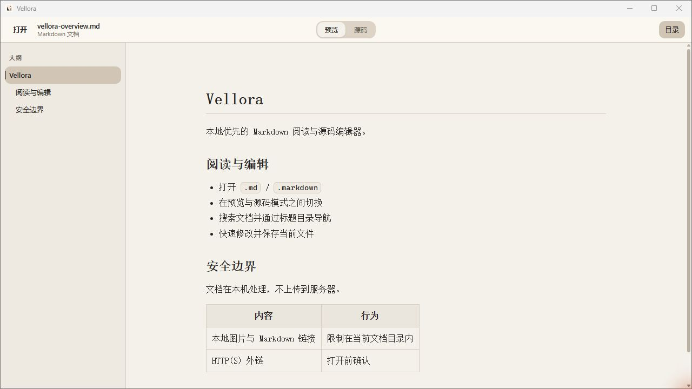

<p align="center">
  
</p>

<h1 align="center">Vellora</h1>

<p align="center">
  Windows / macOS 対応のローカル優先・軽量 Markdown ビューア / ソースエディタです。
</p>

<p align="center">
  <a href="https://github.com/mirad-tech/vellora/actions/workflows/ci.yml"></a>
  <a href="https://github.com/mirad-tech/vellora/releases/latest"></a>
  <a href="LICENSE"></a>
</p>

<p align="center">
  <a href="README.md">中文</a> ·
  <a href="README.en.md">English</a> ·
  <a href="README.ru.md">Русский</a>
</p>

<p align="center">
  
</p>

現在のバージョンは **2.2.5**。**Tauri 2 + React + TypeScript + Vite** で構築されています。ドキュメントはローカルで処理し、サーバーへアップロードしません。

リポジトリ：[`mirad-tech/vellora`](https://github.com/mirad-tech/vellora)。製品名は **Vellora** です。

## ダウンロード

| プラットフォーム | 対応状況 | 入手方法 |
|---|---|---|
| Windows 10/11 x64 | 現在の公開版は 2.2.5 | NSIS インストーラをダウンロード |
| macOS 12+（Apple Silicon / Intel） | ソースと Universal DMG ビルドを両アーキテクチャの CI で検証済み。正式な macOS Release アセットは未提供 | ソースから ad-hoc テスト版をビルド |

### Windows 10/11 x64

[**Vellora 2.2.5 インストーラ**](https://github.com/mirad-tech/vellora/releases/download/v2.2.5/Vellora_2.2.5_x64-setup.exe)

- ファイル名：`Vellora_2.2.5_x64-setup.exe`
- 全リリース：[Releases](https://github.com/mirad-tech/vellora/releases)
- **WebView2** が必要（通常は OS に同梱。インストールパッケージには埋め込みません）
- 1.x（Electron）から：先に 1.x をアンインストールしてから最新版を入れてください

### macOS 12+

ソースは引き続き `arm64` / `x86_64` を含む Universal アプリと DMG に対応しています。正式な GitHub Release は Windows NSIS のみを公開し、macOS DMG はローカル / CI 用の ad-hoc 検証成果物で、正式な Release アセットではありません。テスト版は [macOS ビルド・検証手順](mac/README.md) を参照してください。

## 概要

- `.md` / `.markdown` の表示・ソース編集・保存
- 相対パス画像、ローカル Markdown リンク、HTTP(S) 外部リンク確認
- 単一インスタンス、未保存確認、プレビュー / ソース両モードでの検索、見出しアウトライン
- Windows は `Ctrl+S` / `Ctrl+F`、macOS は `⌘S` / `⌘F`。プレビューとソース表示は同じ右端スクロールバーを使用

## 開発

Node.js 22.22.2+（22.x）、24.15+（24.x）または 26+ が必要です。

```bash
npm install
npm run dev
npm run dist
```

macOS では `npm run dev:mac`、`npm run test:e2e:mac`、`npm run dist:mac` を使用します。

## ライセンス

MIT — [LICENSE](LICENSE)
