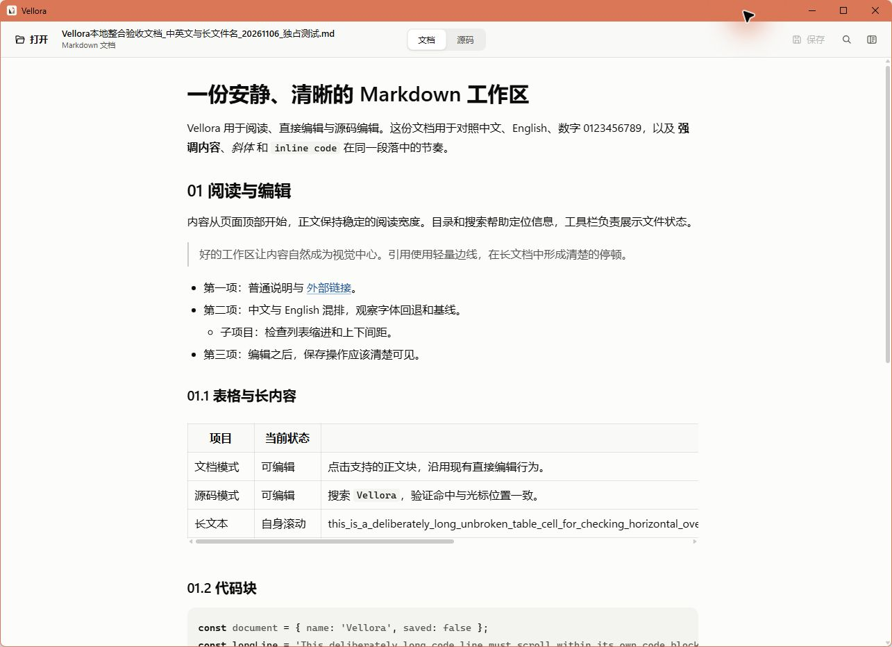

<p align="center">
  
</p>

<h1 align="center">Vellora</h1>

<p align="center">
  Windows で検証したローカル優先・軽量 Markdown ビューア / ソースエディタです。
</p>

<p align="center">
  <a href="https://github.com/mirad-tech/vellora/actions/workflows/ci.yml"></a>
  <a href="https://github.com/mirad-tech/vellora/releases/latest"></a>
  <a href="LICENSE"></a>
</p>

<p align="center">
  <a href="README.md">中文</a> ·
  <a href="README.en.md">English</a> ·
  <a href="README.ru.md">Русский</a>
</p>

<p align="center">
  
</p>

現在のソースバージョンは **2.4.3**（公開版はダウンロード欄を参照）。**Tauri 2 + React + TypeScript + Vite** で構築されています。ドキュメントはローカルで処理し、サーバーへアップロードしません。

リポジトリ：[`mirad-tech/vellora`](https://github.com/mirad-tech/vellora)。製品名は **Vellora** です。

## ダウンロード

| プラットフォーム | 対応状況 | 入手方法 |
|---|---|---|
| Windows 10/11 x64 | 現在のバージョン: 2.4.3 | NSIS インストーラをダウンロード |
| macOS | Windows のソースとローカル検証版は **2.4.3** です。`mac/` ビルドスクリプトは削除されており、残っている macOS npm/CI エントリは現在利用できません。 | — |

### Windows 10/11 x64

[**Vellora 2.4.3 インストーラ**](https://github.com/mirad-tech/vellora/releases/download/v2.4.3/Vellora_2.4.3_x64-setup.exe)

- 全リリース：[Releases](https://github.com/mirad-tech/vellora/releases)
- **WebView2** が必要（通常は OS に同梱。インストールパッケージには埋め込みません）
- 1.x（Electron）から：先に 1.x をアンインストールしてから最新版を入れてください

### macOS

Windows のソースとローカル検証版は **2.4.3** です。`mac/` ビルドスクリプトは削除されており、残っている macOS npm/CI エントリは現在利用できません。

## 概要

- `.md` / `.markdown` の表示・ソース編集・保存
- 相対パス画像、ローカル Markdown リンク、HTTP(S) 外部リンク確認
- 単一インスタンス、未保存確認、プレビュー / ソース両モードでの検索、見出しアウトライン
- Windows は `Ctrl+S` / `Ctrl+F`、macOS は `⌘S` / `⌘F`。プレビューとソース表示は同じ右端スクロールバーを使用

## 開発

Node.js 22.22.2+（22.x）、24.15+（24.x）または 26+ が必要です。

```bash
npm ci
npm run dev
npm run dist
```

Windows のソースとローカル検証版は **2.4.3** です。`mac/` ビルドスクリプトは削除されており、残っている macOS npm/CI エントリは現在利用できません。

## ライセンス

MIT — [LICENSE](LICENSE)

## UI 回帰テスト

```powershell
npm run version:check
npm run test:e2e:prepare
npm run test:e2e
npm run tools:msedgedriver
npm run test:e2e:desktop
```

[Chrome と tauri-driver の準備手順](tests/e2e/README.md)。
