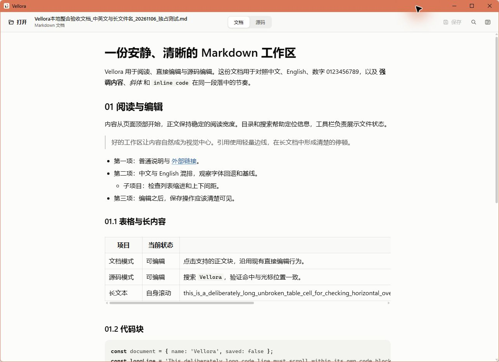

<p align="center">
  
</p>

<h1 align="center">Vellora</h1>

<p align="center">
  Локальный лёгкий просмотрщик и редактор Markdown для Windows.
</p>

<p align="center">
  <a href="https://github.com/mirad-tech/vellora/actions/workflows/ci.yml"></a>
  <a href="https://github.com/mirad-tech/vellora/releases/latest"></a>
  <a href="LICENSE"></a>
</p>

<p align="center">
  <a href="README.md">中文</a> ·
  <a href="README.en.md">English</a> ·
  <a href="README.ja.md">日本語</a>
</p>

<p align="center">
  
</p>

Текущая версия исходного кода — **2.4.3** (публичный выпуск указан в разделе загрузки), на **Tauri 2 + React + TypeScript + Vite**. Документы обрабатываются локально и не загружаются на сервер.

Репозиторий: [`mirad-tech/vellora`](https://github.com/mirad-tech/vellora). Продукт: **Vellora**.

## Скачать

| Платформа | Статус поддержки | Как получить |
|---|---|---|
| Windows 10/11 x64 | Текущая версия: 2.4.3 | Скачать установщик NSIS |
| macOS | Версия исходников и локально проверенной сборки Windows — **2.4.3**. Скрипты сборки `mac/` удалены; оставшиеся команды npm и задания CI для macOS сейчас не работают. | — |

### Windows 10/11 x64

[**Установщик Vellora 2.4.3**](https://github.com/mirad-tech/vellora/releases/download/v2.4.3/Vellora_2.4.3_x64-setup.exe)

- Все версии: [Releases](https://github.com/mirad-tech/vellora/releases)
- Нужен **WebView2** (обычно уже есть в системе; runtime не вшивается в установщик)
- С 1.x (Electron): сначала удалите 1.x, затем установите последнюю версию

### macOS

Версия исходников и локально проверенной сборки Windows — **2.4.3**. Скрипты сборки `mac/` удалены; оставшиеся команды npm и задания CI для macOS сейчас не работают.

## Кратко

- Открытие `.md` / `.markdown`, чтение, правка исходника, сохранение
- Относительные изображения, локальные Markdown-ссылки, подтверждение HTTP(S)
- Один экземпляр, защита несохранённых изменений, поиск в режиме просмотра и исходника, оглавление
- Windows: `Ctrl+S` / `Ctrl+F`; macOS: `⌘S` / `⌘F`; просмотр и исходник используют общую полосу прокрутки справа

## Разработка

Нужен Node.js 22.22.2+ (22.x), 24.15+ (24.x) или 26+.

```bash
npm ci
npm run dev
npm run dist
```

Версия исходников и локально проверенной сборки Windows — **2.4.3**. Скрипты сборки `mac/` удалены; оставшиеся команды npm и задания CI для macOS сейчас не работают.

## Лицензия

MIT — [LICENSE](LICENSE)

## Проверка интерфейса

```powershell
npm run version:check
npm run test:e2e:prepare
npm run test:e2e
npm run tools:msedgedriver
npm run test:e2e:desktop
```

[Подготовка Chrome и tauri-driver](tests/e2e/README.md).
