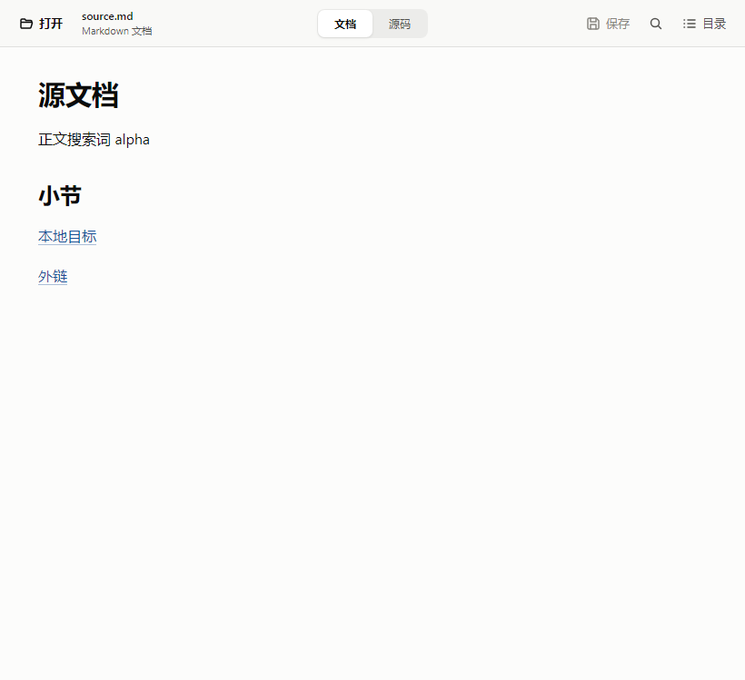
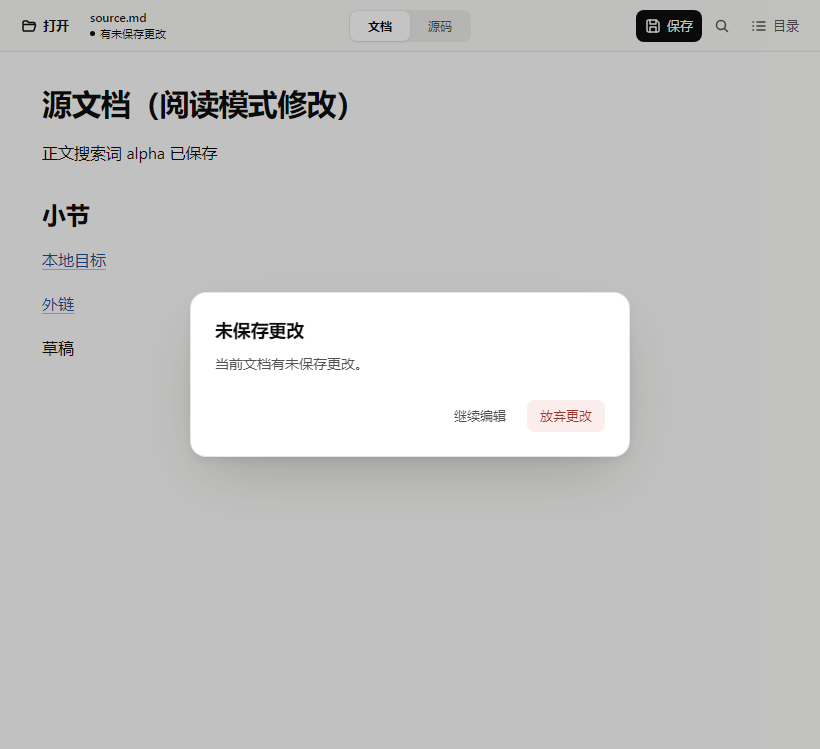

# 界面精修：实际渲染对照

这些图片来自 [Windows UI validation 42091389244](https://github.com/mirad-tech/vellora/actions/runs/42091389244) 的真实 Chrome 渲染，不是设计稿。

- 原版源码：`7f0bd506d1aa81d463d6f6cdd54980240a18522a`。
- 新版源码：`47bb5eaed30dbac43c801a20d7188d581a01cad6`。
- 浏览器：Windows 上的 Chrome 156.0.8078.80，设备缩放比例 1。
- 两组使用相同的[综合样本文档](../../tests/fixtures/markdown/06-ui-polish.md)、长中文文件名和窗口尺寸。
- 前端截图使用测试用 Tauri 响应模拟文件操作；本页后半部分另列实际 Tauri WebView 截图。调整测试环境后的 [Windows 验证 42094282845](https://github.com/mirad-tech/vellora/actions/runs/42094282845) 已通过全部门禁和真实 IPC 综合回归，详见[设计与验证记录](../../FRONTEND_DESIGN_PACK.md)。
- 原版代表远端代码基线，不包括维护者尚未上传的本地界面改动。

## 默认 820×900 窗口

### 改造前

### 改造后

新版统一了字体和表面层级，缩短首屏上方空白，集中保存、查找、目录操作，并让长表格在自身容器滚动。表格列设置最小宽度，避免中文列被长值挤成竖排。

## 最小 640px 宽度

## 源码与搜索

实测 textarea 与高亮覆盖层的坐标、宽度、字体、行高、内边距与换行规则一致。

## 窄窗口目录

目录浮层保留原文阅读宽度；点击外部不消耗目标控件的点击，Escape 关闭后回到目录按钮。

## 原生 Tauri / WebView2 截图

以下 5 张图片来自提交 `ec67cf6d6134b2f3957b39cb6c8ec921dcc29340` 的[成功原生运行](https://github.com/mirad-tech/vellora/actions/runs/42094282845)，通过真实 Tauri IPC 打开和保存本次测试的临时文档，没有模拟文件响应。

- 系统：Windows 2022 镜像 `20261101.353.1`。
- WebView2 Runtime 与实际使用的 Microsoft 驱动：均为 `131.0.2903.86`。
- 每张截图内容区实际为 **820×749**，不包含系统原生标题栏；它们与上面的 820×900 浏览器对照使用不同样本文档，不能进行逐像素前后比较。
- 原生综合用例通过后，对这 5 张截图逐一检查了文字、控件对齐与浮层裁切；真实输入法及系统缩放仍列入人工验收。

### 原生文档

### 原生未保存确认

其他原生状态：

| 状态 | 实际截图 |
| --- | --- |
| 源码编辑与未保存内容 | [查看源码截图](native-source-dirty.png) |
| 搜索与浮层目录 | [查看搜索和目录](native-search-outline.png) |
| 外链确认 | [查看外链确认](native-external-confirmation.png) |

搜索与目录截图中，测试目标文档只有短标题和两行文字，位于目录浮层覆盖范围；右侧留白不表示内容丢失。

## 完整证据

- [本页浏览器前后对照的原始产物](https://github.com/mirad-tech/vellora/actions/runs/42091389244/artifacts/13444399471)：提交 `47bb5ea`，18 张截图及两份 `metrics.json`，包含空白、错误和确认框场景。
- [最终成功运行的完整产物](https://github.com/mirad-tech/vellora/actions/runs/42094282845/artifacts/13447721680)：提交 `ec67cf6`，38 个文件，包含本轮重新捕获的对照图、浏览器回归图和 5 张原生图。

Actions 产物有 14 天保留期限。本目录保留主要浏览器对照及全部 5 张原生图，均为原始 PNG，未合成或修改。
