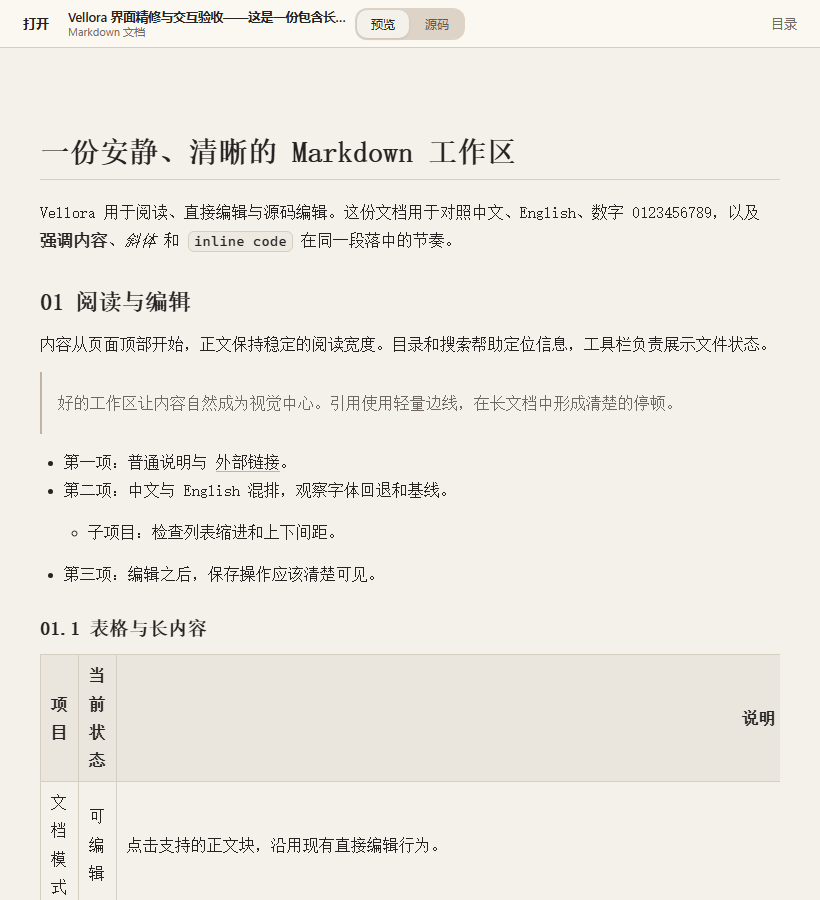
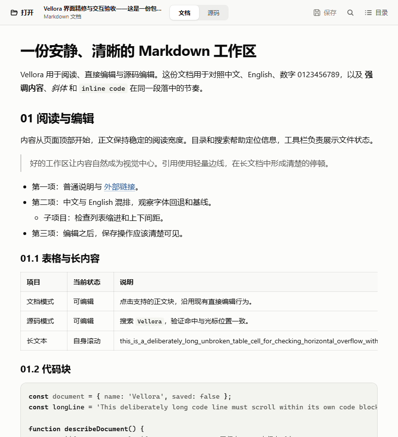
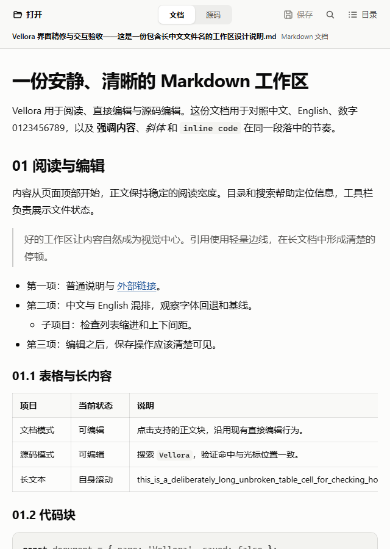
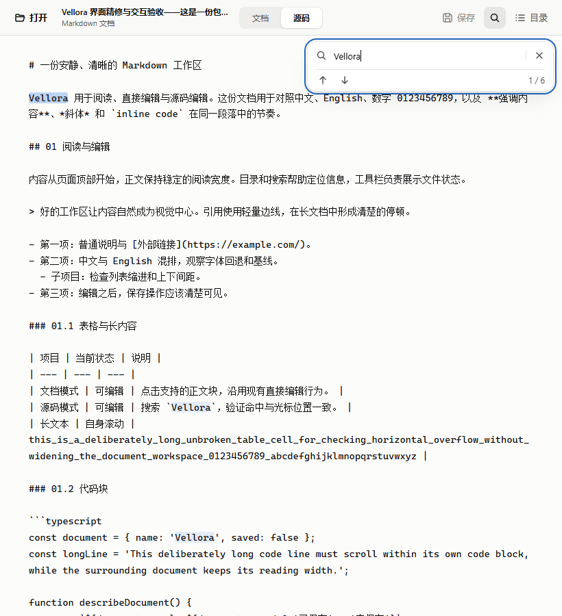
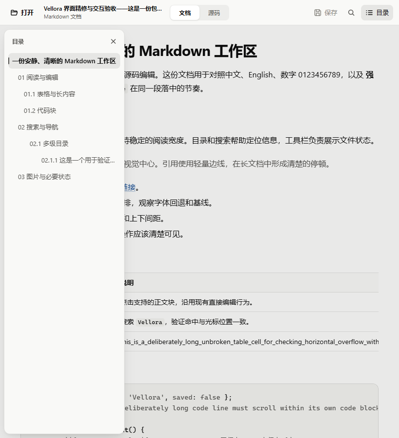

# 界面精修：实际渲染对照

这些图片来自 [Windows UI validation 42091389244](https://github.com/mirad-tech/vellora/actions/runs/42091389244) 的真实 Chrome 渲染，不是设计稿。

- 原版源码：`7f0bd506d1aa81d463d6f6cdd54980240a18522a`。
- 新版源码：`47bb5eaed30dbac43c801a20d7188d581a01cad6`。
- 浏览器：Windows 上的 Chrome 156.0.8078.80，设备缩放比例 1。
- 两组使用相同的[综合样本文档](../../tests/fixtures/markdown/06-ui-polish.md)、长中文文件名和窗口尺寸。
- 前端截图使用测试用 Tauri 响应模拟文件操作。本次真实 Tauri/IPC 回归在创建 WebView2 会话时失败，未进入产品断言；测试环境调整后的复验待记录，详见[设计与验证记录](../../FRONTEND_DESIGN_PACK.md)。
- 原版代表远端代码基线，不包括维护者尚未上传的本地界面改动。

## 默认 820×900 窗口

### 改造前

### 改造后

新版统一了字体和表面层级，缩短首屏上方空白，集中保存、查找、目录操作，并让长表格在自身容器滚动。表格列设置最小宽度，避免中文列被长值挤成竖排。

## 最小 640px 宽度

## 源码与搜索

实测 textarea 与高亮覆盖层的坐标、宽度、字体、行高、内边距与换行规则一致。

## 窄窗口目录

目录浮层保留原文阅读宽度；点击外部不消耗目标控件的点击，Escape 关闭后回到目录按钮。

## 完整证据

[下载本次前后对照与渲染度量](https://github.com/mirad-tech/vellora/actions/runs/42091389244/artifacts/13444399471)。该 GitHub Actions 产物包含 18 张截图及两份 `metrics.json`，另有空白、错误和确认框场景；产物有保留期限，本目录保留了主要对照图。
